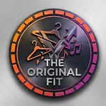

# Originalfit · Boutique sportswear en ligne

> Sélection de vêtements de sport, Made in Morocco—parcourez les styles, composez votre sélection, envoyez-la sur Instagram DM. Prix sur demande.

<div align="center">



[](https://nextjs.org/)
[](https://www.typescriptlang.org/)
[](https://tailwindcss.com/)
[](https://www.mongodb.com/)

</div>

---

## 🎯 Le concept

Originalfit applique le sportswear à la vie quotidienne : bien-être, confort, un look qui dure toute la journée.

Le site fonctionne comme un **vitrine de sélection**, pas une boutique en ligne classique :

1. **Parcourez les styles** — grille filtrable de pièces sportswear (Hauts, Bas, Accessoires).
2. **Composez « Ma sélection »** — choisissez une taille, ajoutez, revisitée à tout moment depuis le tiroir de sélection.
3. **Envoyez via Instagram DM** — la sélection est copiée dans le presse-papiers et Instagram s'ouvre avec le message prêt à envoyer.

Les prix sont révélés sur demande : contactez [@originalfit.ma](https://www.instagram.com/originalfit.ma/) en DM.

---

## 🧩 Sections du site

| Section | Ancres | Contenu |
| --- | --- | --- |
| Accueil | `/` | Hero typographique editorial + marquee |
| À propos | `/#apropos` | Manifeste Originalfit |
| Styles | `/#styles` | Grille de 6 styles d'inspiration, filtres catégorie, sélection de taille |
| Comment ça marche | `/#how-it-works` | 3 étapes : Parcourir · Sélectionner · DM |
| Contact | `/#contact` | Instagram, WhatsApp, emplacements |

Les anciennes routes ENSA redirigent vers les nouvelles ancres (`/products → /#styles`, `/contact → /#contact`, etc.).

---

## 🛠 Stack technique

- **Framework** : Next.js 14 App Router, TypeScript, React Server Components.
- **Styling** : Tailwind CSS — palette éditoriale `bone #F2EFE6`, `ink #111110`, accent `volt #C24657`.
- **Données** : MongoDB + Mongoose (Product, Order, Settings…).
- **État** : React Context (`SelectionContext`, localStorage `originalfit-selection-v1`).
- **SEO** : metadata, sitemap, robots.txt, données structurées, image OG générée via sharp.

---

## 🧭 Architecture

```
src/
├─ app/                  # Routeurs (accueil Originalfit, admin, api, redirections legacy)
├─ components/
│  ├─ originalfit/       # SiteHeader, Hero, About, Styles, HowItWorks, Contact, Footer, ProductArt
│  └─ admin/             # Suite admin conservée (legacy ENSA)
├─ contexts/             # SelectionContext (Ma sélection), AuthContext
├─ lib/                  # inspirations.ts, brand.ts, database-seeder.ts
└─ models/               # Modèles Mongoose
public/
├─ images/originalfit/   # Visuels d'inspiration
└─ images/products/      # Visuels produits (dossier product → 20 images)
```

---

## 🚀 Démarrage rapide

```bash
git clone https://github.com/bnlchb/store-site.git
cd store-site
npm install
npm run dev
# http://localhost:3000
```

### Variables d'environnement

Créez un fichier `.env.local` :

```
MONGODB_URI=mongodb://localhost:27017/originalfit
CLOUDINARY_CLOUD_NAME=...
CLOUDINARY_API_KEY=...
CLOUDINARY_API_SECRET=...
```

### Peupler la base (26 produits d'exemple)

```bash
npm run seed-db
```

Les produits sont livrés avec `price: 0` (**prix sur demande**) et `isOrderingEnabled: false`.

---

## 📦 Catalogue d'exemple

| Catégorie | Exemples |
| --- | --- |
| Hauts | T-shirt training, Hoodie sport, Sweats, Vestes — 6 coloris |
| Bas | Shorts, Jogging, Pantalon, Legging |
| Accessoires | Sneakers, Sac crossbody, Sac à dos, Pochette, Casquette |

---

## 🔐 Admin (conservé du projet d'origine)

- `/admin` — auth `/api/auth/login`, gestion produits, commandes, paramètres, analytics.
- `/api/products`, `/api/orders`, `/api/settings`, `/api/upload`, `/api/seed` — API REST complète.

---

**Originalfit** — la sélection que vous envoyez, le style qui vous suit.
© 2026 Originalfit. Projet personnel conçu avec amour, café et beaucoup de 🤍♻️.
